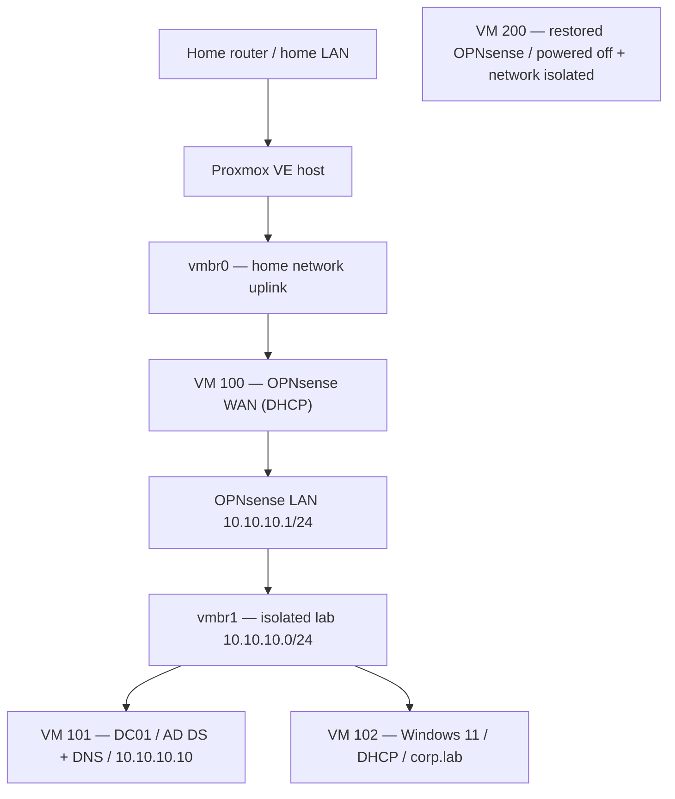

# Network Documentation — Proxmox IT Support Homelab

The following is a **logical topology** and configuration reference, based on the network-documentation exercise of 22 October 2026. It is not a physical cabling diagram or proof of tested internet reachability.

## Logical topology

**VM 200 is intentionally disconnected** from the active topology.

## Infrastructure inventory

| Component | Function |
|---|---|
| Proxmox VE host | Virtualisation host on the home LAN |
| `vmbr0` | Home-network uplink for OPNsense WAN |
| `vmbr1` | Isolated `10.10.10.0/24` virtual lab network |
| VM 100 — OPNsense | Firewall, router, Kea DHCP; WAN via `vmbr0`, LAN `10.10.10.1/24` via `vmbr1` |
| VM 101 — DC01 | Windows Server 2025, AD DS, DNS; `10.10.10.10/24`, on `vmbr1` |
| VM 102 — Windows 11 | Enterprise workstation, domain-joined to `corp.lab`, DHCP via `vmbr1` |
| VM 200 — OPNsense restore | Isolated recovery copy; powered off after test |

The private home-network management IP has been omitted from this public-facing reference.

## Addressing and services

| Setting | Lab value |
|---|---|
| AD domain and DNS zone | `corp.lab` |
| Lab subnet | `10.10.10.0/24` |
| Gateway | `10.10.10.1` (OPNsense) |
| DHCP pool | `10.10.10.100–10.10.10.200` (Kea) |
| DHCP-provided DNS server | `10.10.10.10` (DC01) |
| DC01 IP / DNS | `10.10.10.10` |
| Windows 11 lease | DHCP `10.10.10.x`; exact lease not recorded |

## Bridge-to-VM verification

| VM | Adapter | Proxmox bridge | Result |
|---|---|---|---|
| 100 | WAN | `vmbr0` | Passed |
| 100 | LAN | `vmbr1` | Passed |
| 101 | Domain controller NIC | `vmbr1` | Passed |
| 102 | Client NIC | `vmbr1` | Passed |

**4/4 active NIC-to-bridge assignments were confirmed.** No configuration changes were required.

## Identity and file services

DC01 operates AD DS and DNS. Lab organisational units include Lab Users, Lab Groups, Lab Workstations and Lab Servers. Fictional test accounts include Alice Smith, Ben Jones and Support Test, with departmental groups `GG_Sales`, `GG_Finance` and `GG_Helpdesk`.

The `\\DC01\Departments` share contains Sales, Finance and Public folders, with group-based NTFS permissions. A user GPO maps the `S:` drive to the departmental share.

## Troubleshooting quick reference

| Symptom | First checks |
|---|---|
| Domain cannot be found | `ipconfig /all`; confirm internal DNS `10.10.10.10`; `nslookup corp.lab` |
| Domain controller not discovered | LDAP SRV lookup; `nltest /dsgetdc:corp.lab` |
| Mapped drive absent or incorrect | `gpupdate /force`, `gpresult /r`, `net use S:` |
| Departmental folder access denied | AD group membership, NTFS/share permissions and refreshed sign-in token |
| Lab connectivity issue | Proxmox bridge, OPNsense LAN and DHCP lease |

## Recovery cross-reference
See [Week 4 — Backup & Recovery](../04-Backup-Recovery/README.md). Backup tasks passed; an isolated OPNsense VM booted after restoration. Full network service restoration and AD System State restoration were **not** tested.

## Scope
This documentation describes a verified logical network, not physical wiring, externally accessible services or comprehensive firewall validation.
